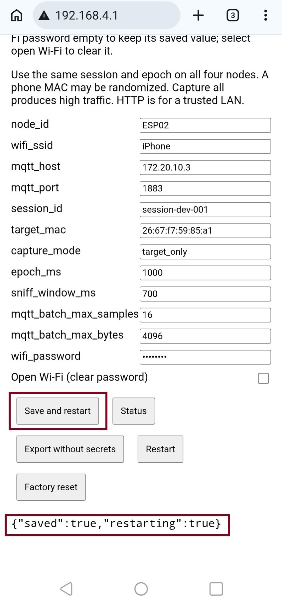

# Hướng dẫn chạy RF Localization

## 1. Kết nối hotspot và xem thông số

Bật hotspot **2.4 GHz**, dữ liệu di động và cho phép ít nhất **5 thiết bị** kết nối: laptop + 4 ESP32. Trên iPhone, bật **Tối đa hóa tương thích** nếu có.

Kết nối laptop vào hotspot. Mở PowerShell:

```powershell
ipconfig
netsh wlan show interfaces
```

Ghi lại thông tin của Wi-Fi đang kết nối:

| Thông số | Lấy ở đâu | Dùng để điền |
|---|---|---|
| IPv4 laptop | `ipconfig` → Wireless LAN adapter Wi-Fi → IPv4 Address | MQTT host |
| SSID | `netsh wlan show interfaces` → SSID | Tên Wi-Fi |
| BSSID | `netsh wlan show interfaces` → BSSID | MAC mục tiêu của điện thoại phát hotspot |
| Channel | `netsh wlan show interfaces` → Channel | Kiểm tra kênh trên ESP32 |

Không lấy Physical address của laptop làm MAC mục tiêu. BSSID có thể đổi khi bật lại hotspot; luôn dùng giá trị vừa đọc.

**IPv4 Wi-Fi → MQTT host** (lệnh script chạy: `ipconfig`):


**BSSID → Target MAC** (lệnh script chạy: `netsh wlan show interfaces`):


Các hình chụp ở thời điểm khác nhau: ảnh BSSID là `EE:80:A9:13:17:4D`, còn ảnh cấu hình bên dưới dùng MAC cũ. Điền BSSID hiện tại giống nhau trên cả 4 ESP32 và gateway, không chép cố định từ ảnh.

## 2. Chuẩn bị laptop — chỉ làm lần đầu

Cài Python, Mosquitto và extension PlatformIO trong VSCode. Mở terminal tại thư mục gốc project:

```powershell
cd "C:\Users\Admin\Downloads\do an"
py -m venv .venv
& .\.venv\Scripts\python.exe -m pip install -r .\requirements.txt
```

Nếu đã có venv hoạt động và đã cài thư viện thì bỏ qua. Không cần activate khi chạy bằng đường dẫn Python như trong hướng dẫn.

Mở PowerShell **Run as administrator**, cho phép ESP32 kết nối broker; nếu đã tạo rule này thì bỏ qua:

```powershell
New-NetFirewallRule -DisplayName "RF MQTT 1883" -Direction Inbound -Action Allow -Protocol TCP -LocalPort 1883 -RemoteAddress LocalSubnet -Profile Any
```

Nếu dịch vụ Mosquitto đang chạy, dừng nó trước khi chạy broker trong VSCode:

```powershell
Get-Service mosquitto
Stop-Service mosquitto
```

## 3. Build, nạp và cấu hình từng ESP32

1. Mở folder `firmware` trong VSCode có PlatformIO. Cắm một ESP32 qua USB.
2. Vào **PlatformIO → Project Tasks → esp32dev → General → Build**.
3. Chọn **Upload and Monitor**.
4. Khi chưa có cấu hình Wi-Fi, ESP32 phát mạng **RF-Setup-…** không mật khẩu. Kết nối laptop vào mạng đó, mở **http://192.168.4.1**.
5. Điền bảng dưới rồi bấm **Save and restart**. Kết nối laptop lại hotspot điện thoại.
6. Lặp lại cho đủ 4 con. Nếu ESP32 đã lưu Wi-Fi, mở IP hiện trong Serial ở dòng `[WIFI] STA IP=…` để chỉnh; giữ BOOT khoảng 3 giây để xóa cấu hình nếu cần làm lại.

| Trường trên web ESP32 | Giá trị |
|---|---|
| `node_id` | Mỗi con một ID: `ESP01`, `ESP02`, `ESP03`, `ESP04` |
| `wifi_ssid` | SSID hotspot điện thoại |
| `wifi_password` | Mật khẩu hotspot; để trống khi sửa sẽ giữ mật khẩu đã lưu |
| `mqtt_host` | IPv4 laptop, ví dụ `172.20.10.3` |
| `mqtt_port` | Giữ `1883` |
| `session_id` | Giống `SESSION_ID` trong `.env`, hiện `session-dev-002`, giống nhau trên cả 4 con |
| `target_mac` | BSSID hotspot, ví dụ `26:67:F7:59:85:A1` |
| `capture_mode` | Giữ `target_only` |
| `epoch_ms` | Giữ `1000` |
| `sniff_window_ms` | Giữ `700` |
| `mqtt_batch_max_samples` | Giữ `16` |
| `mqtt_batch_max_bytes` | Giữ `4096` |

Không chọn **Open Wi-Fi** nếu hotspot có mật khẩu. Không cần sửa code theo từng node; cấu hình được lưu trên ESP32. `DEVICE_TOKEN_SALT` trong firmware và gateway phải giống nhau; giữ mặc định nếu chưa thay đổi.

**Cấu hình cũ lưu trong NVS** — thay Wi-Fi, MQTT host và Target MAC theo mạng hiện tại:


**Sau khi điền và bấm Save and restart**, trang trả về `saved: true, restarting: true`:



**Sau khi ESP32 kết nối hotspot**, đọc IP của ESP tại dòng `[WIFI] STA IP=…` để mở lại web cấu hình. Đây là IP ESP32, không phải MQTT host:


Ảnh Serial có lỗi MQTT vì broker chưa sẵn sàng lúc chụp. Kết nối Wi-Fi thành công chưa có nghĩa MQTT đã kết nối; tiếp tục mục 4.

## 4. Cấu hình chung trong .env

Chỉ sửa `.env` ở thư mục gốc, rồi khởi động lại các chương trình liên quan.
Ba file .bat ưu tiên cấu hình .env hơn biến cũ trong terminal.

| Biến | Công dụng |
|---|---|
| COLLECTION_MODE | true: thu RSSI thô; false: định vị WCL/EMA và AI |
| SESSION_ID | Session mặc định trên web và AI; phải giống 4 ESP32 |
| MQTT_HOST / MQTT_PORT | IPv4 laptop và cổng broker MQTT |
| TARGET_DEVICE_MAC | MAC mục tiêu; BSSID khi định vị điện thoại hotspot |
| COLLECTION_CSV_PATH | File dữ liệu thô, hiện database/house_collect.csv |
| COLLECTION_DURATION_S | Thời gian một lượt đo, hiện 30 giây |
| COLLECTION_RECEIVE_WAIT_MS | Chờ gói đến trễ, hiện 3000 ms, không kéo dài thời gian đo |
| REALTIME_CSV_PATH | File kết quả định vị WCL/EMA, hiện database/localization.csv |
| ROOM_WIDTH_M / ROOM_LENGTH_M | Phòng 4.3 × 4.2 m |
| GRID_CELL_WIDTH_M / GRID_CELL_LENGTH_M | Ô 0.3 × 0.3 m |
| AI_MODEL_PATH / AI_DATASET_PATH | Model và dataset vector dành riêng cho train |
| AI_WINDOW_SIZE | Cửa sổ train, hiện 10 vector; không dùng trong luồng thu thô |

DEVICE_TOKEN_SALT phải khớp firmware. Đổi IP/MAC/session trong .env cũng cần chỉnh
trên web từng ESP32; .env không tự đẩy cấu hình xuống node.
Đổi cổng web thì chỉnh cả GATEWAY_PORT và GATEWAY_URL.
Thay đổi phòng trên dashboard chỉ áp dụng trong lần chạy hiện tại; sửa .env để giữ sau restart.

## 5. Chạy hệ thống

Chạy mỗi lệnh ở một terminal tại thư mục dự án; hoặc nhấp đúp file .bat:

~~~powershell
.\scripts\run_mosquitto.bat
~~~

~~~powershell
.\scripts\run_gateway.bat
~~~

Chỉ chạy AI khi COLLECTION_MODE=false:

~~~powershell
.\scripts\run_ai.bat
~~~

Mở http://127.0.0.1:8000, nhấn Ctrl+F5. Dừng broker/gateway cũ trước để tránh trùng cổng.
Không cần kích hoạt venv khi chạy .bat, cũng không cần nạp lại ESP32 khi chỉ sửa gateway.

scripts/launch.py đọc .env rồi gọi chương trình tương ứng.
scripts/mosquitto.conf là mẫu cấu hình broker; launcher thay ${MQTT_PORT} bằng cổng
trong .env rồi truyền config tạm cho Mosquitto. Không chạy trực tiếp file mẫu.
Android và iPhone đều chỉ cần một broker.

## 6. Luồng thu RSSI thô và lưu CSV

Đặt COLLECTION_MODE=true trong .env, rồi chạy Mosquitto và gateway.

~~~text
Điện thoại phát Wi-Fi
  -> ESP32 bắt frame: RSSI gốc + capture_unix_ms của chính ESP32
  -> Queue / task gửi đóng gói nhiều mẫu gốc thành MQTT JSON
  -> Mosquitto chuyển tiếp tới gateway
  -> Gateway xác định session, lượt đo và thời điểm bắt mẫu
  -> Ghi ngay từng mẫu vào CSV, không median, mean, smoothing hoặc WCL
~~~

Chọn ô, đặt điện thoại đúng tâm vàng, xác nhận rồi bấm Start Measurement.
Lượt đo bắt đầu ngay trong COLLECTION_DURATION_S giây.
Receiving sau đó chỉ chờ những mẫu đã bắt trong khoảng đo nhưng tới gateway muộn.
Mẫu ngoài khoảng đo hoặc ngoài lượt đo đang chạy không được gắn nhãn để lưu.
Gói MQTT gửi lặp chỉ ghi một lần; các frame riêng biệt có cùng RSSI/timestamp vẫn giữ đủ.

ESP32 vẫn dùng firmware cũ: mỗi chu kỳ 1000 ms bắt frame trong 700 ms rồi gửi batch.
Gateway không chọn lại mẫu theo cửa sổ 1 giây, không ghép mẫu các node và không sửa RSSI.
Chỉ lưu mẫu của target đã chọn; NTP cần đồng bộ để timestamp có nghĩa.

CSV chính đúng 8 cột:

~~~csv
session,timestamp,Zone,ESP01 - RSSI,ESP02 - RSSI,ESP03 - RSSI,ESP04 - RSSI,Vector RSSI
session-dev-002,2026-11-18T09:30:00.123Z,Z1_run01,-51,NULL,NULL,NULL,"[-51,null,null,null]"
session-dev-002,2026-11-18T09:30:00.127Z,Z1_run01,NULL,-62,NULL,NULL,"[null,-62,null,null]"
session-dev-002,2026-11-18T09:30:00.128Z,Z1_run01,-53,NULL,NULL,NULL,"[-53,null,null,null]"
~~~

Mỗi dòng là MỘT frame của MỘT ESP32. Timestamp là thời điểm ESP bắt frame,
chuyển nguyên vẹn từ Unix ms sang UTC có đúng 3 chữ số mili giây.
Z nghĩa là UTC, không phải giờ Việt Nam. Thứ tự dòng là thứ tự nhận qua MQTT;
có thể lệch thứ tự timestamp giữa các ESP. Không thay timestamp bằng giờ laptop
hoặc làm tròn về đầu giây. NULL ở 3 node còn lại là vì dòng đó thuộc một node,
không phải bị mất ba mẫu. Không tạo dòng NULL giả khi không có frame.

Đo lại cùng Session + Zone tăng nhãn Z1_run01, Z1_run02... Kể cả chạy lại gateway
vẫn tiếp tục số run đã lưu; session khác bắt đầu lại run01.
Không ghép các run lại thành Z1 trong file.

File lưu trực tiếp tại COLLECTION_CSV_PATH, không cần bấm download mới được lưu.
Nút Download Raw CSV tải các dòng của session đang chọn.
Bảng web hiển thị tối đa 50 mẫu mới nhất, file CSV giữ toàn bộ mẫu.

Cạnh CSV chính có file *_runs.csv: chỉ lưu metadata lượt đo, phòng, số mẫu và trạng thái.
Không đưa file này vào train và không xóa nếu muốn giữ lịch sử trên web.
Completed nghĩa là kết thúc lượt, đã có mẫu từ cả 4 node và không ghi nhận gián đoạn;
Partial vẫn giữ mọi mẫu đã ghi, không thêm hoặc suy đoán giá trị thiếu.

Mỗi batch được ghi/flush xuống đĩa ngay. Nếu dừng gateway giữa lượt, lượt đó thành Partial.
Nếu mất điện hoặc tiến trình bị kill, dữ liệu đã ghi vẫn còn; lượt chưa hoàn tất
được đánh dấu Partial khi mở lại. Có thể mất batch đang ghi lúc xảy ra lỗi.
Không mở file đang thu bằng chương trình khóa quyền ghi; tải một bản CSV để xem bằng Excel.

## 7. Timestamp và dữ liệu cũ

Excel hiện 1.79E+12 có thể chỉ là cách hiển thị số. Kiểm tra CSV bằng VSCode để biết
file còn nguyên 13 chữ số hay đã bị lưu lại dạng làm tròn.
CSV mới dùng UTC dạng 2026-11-18T09:30:00.123Z nên không hiện số khoa học.

Nếu CSV cũ đã bị Excel ghi đè/làm tròn, không thể tự khôi phục các chữ số bị mất.
Cần bản xuất gốc hoặc dữ liệu gốc tương ứng.
Các file .db cũ được giữ nguyên để không mất dữ liệu; gateway mới không đọc/ghi
SQLite và không tự chuyển dữ liệu cũ sang CSV. CSV mới bắt đầu từ dữ liệu đo mới.
Code SQLite và các luồng tổng hợp/di trú DB cũ đã bỏ.

## 8. Định vị / AI

Đặt COLLECTION_MODE=false, chạy cả 3 file .bat.
Luồng định vị vẫn ghép vector RSSI, WCL/EMA và WebSocket như trước;
yêu cầu đủ 4 node, đủ chunk, NTP và overlap tối thiểu 600 ms.
Kết quả WCL/EMA được ghi CSV tại REALTIME_CSV_PATH.
Chấm tím là AI, cam là WCL, xanh là WCL/EMA.
Không ghi CSV tọa độ AI riêng.

Thu thô và train là hai việc khác nhau. CSV mới là frame rời của từng ESP,
không thể coi 10 dòng raw là 10 vector đồng bộ/10 giây.
Script train sẽ từ chối CSV chỉ gồm các frame một node, tránh train nhầm.
Muốn train từ dữ liệu mới cần bước chuẩn bị vector riêng, không ghi đè CSV thô.
Dataset vector cũ trong model/dataset-vectors.csv và model hiện tại không bị sửa.

Train lại bằng dataset vector đã chuẩn bị:

~~~powershell
& .\.venv\Scripts\python.exe .\model\train_regression.py
~~~

CSV có nhãn Z1_run01 được giữ riêng từng run khi tạo cửa sổ;
tọa độ và chia Zone đánh giá vẫn dùng Z1. Sai số model cần đánh giá bằng lần đo mới,
không lấy tọa độ WCL làm nhãn thật.

## 9. File code cần xem

- gateway/collection.py: nhận frame, gắn lượt đo, thời gian đo và trạng thái.
- gateway/csv_store.py: chuyển timestamp UTC, ghi CSV thô, lưu metadata và xuất CSV.
- gateway/main.py: nối MQTT, API, CSV, dashboard và luồng định vị.
- gateway/static/index.html: chọn ô, bắt đầu đo, xem frame và tải CSV.
