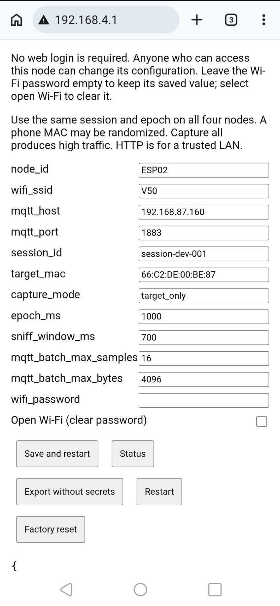
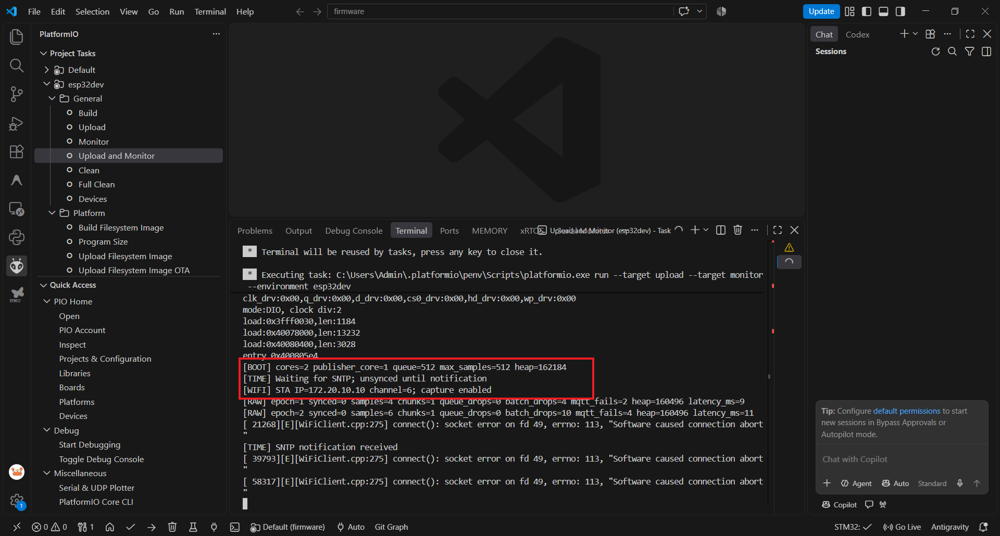

# Hướng dẫn chạy RF Localization

## 1. Kết nối hotspot và xem thông số

Bật hotspot **2.4 GHz**, dữ liệu di động và cho phép ít nhất **5 thiết bị** kết nối: laptop + 4 ESP32. Trên iPhone, bật **Tối đa hóa tương thích** nếu có.

Kết nối laptop vào hotspot. Mở PowerShell:

```powershell
ipconfig
netsh wlan show interfaces
```

Ghi lại thông tin của Wi-Fi đang kết nối:

| Thông số | Lấy ở đâu | Dùng để điền |
|---|---|---|
| IPv4 laptop | `ipconfig` → Wireless LAN adapter Wi-Fi → IPv4 Address | MQTT host |
| SSID | `netsh wlan show interfaces` → SSID | Tên Wi-Fi |
| BSSID | `netsh wlan show interfaces` → BSSID | MAC mục tiêu của điện thoại phát hotspot |
| Channel | `netsh wlan show interfaces` → Channel | Kiểm tra kênh trên ESP32 |

Không lấy Physical address của laptop làm MAC mục tiêu. BSSID có thể đổi khi bật lại hotspot; luôn dùng giá trị vừa đọc.

**IPv4 Wi-Fi → MQTT host** (lệnh script chạy: `ipconfig`):


**BSSID → Target MAC** (lệnh script chạy: `netsh wlan show interfaces`):


Các hình chụp ở thời điểm khác nhau: ảnh BSSID là `EE:80:A9:13:17:4D`, còn ảnh cấu hình bên dưới dùng MAC cũ. Điền BSSID hiện tại giống nhau trên cả 4 ESP32 và gateway, không chép cố định từ ảnh.

## 2. Chuẩn bị laptop — chỉ làm lần đầu

Cài Python, Mosquitto và extension PlatformIO trong VSCode. Mở terminal tại thư mục gốc project:

```powershell
cd "C:\Users\Admin\Downloads\do an"
py -m venv .venv
& .\.venv\Scripts\python.exe -m pip install -r .\requirements.txt
```

Nếu đã có venv hoạt động và đã cài thư viện thì bỏ qua. Không cần activate khi chạy bằng đường dẫn Python như trong hướng dẫn.

Mở PowerShell **Run as administrator**, cho phép ESP32 kết nối broker; nếu đã tạo rule này thì bỏ qua:

```powershell
New-NetFirewallRule -DisplayName "RF MQTT 1883" -Direction Inbound -Action Allow -Protocol TCP -LocalPort 1883 -RemoteAddress LocalSubnet -Profile Any
```

Nếu dịch vụ Mosquitto đang chạy, dừng nó trước khi chạy broker trong VSCode:

```powershell
Get-Service mosquitto
Stop-Service mosquitto
```

## 3. Build, nạp và cấu hình từng ESP32

1. Mở folder `firmware` trong VSCode có PlatformIO. Cắm một ESP32 qua USB.
2. Vào **PlatformIO → Project Tasks → esp32dev → General → Build**.
3. Chọn **Upload and Monitor**.
4. Khi chưa có cấu hình Wi-Fi, ESP32 phát mạng **RF-Setup-…** không mật khẩu. Kết nối laptop vào mạng đó, mở **http://192.168.4.1**.
5. Điền bảng dưới rồi bấm **Save and restart**. Kết nối laptop lại hotspot điện thoại.
6. Lặp lại cho đủ 4 con. Nếu ESP32 đã lưu Wi-Fi, mở IP hiện trong Serial ở dòng `[WIFI] STA IP=…` để chỉnh; giữ BOOT khoảng 3 giây để xóa cấu hình nếu cần làm lại.

| Trường trên web ESP32 | Giá trị |
|---|---|
| `node_id` | Mỗi con một ID: `ESP01`, `ESP02`, `ESP03`, `ESP04` |
| `wifi_ssid` | SSID hotspot điện thoại |
| `wifi_password` | Mật khẩu hotspot; để trống khi sửa sẽ giữ mật khẩu đã lưu |
| `mqtt_host` | IPv4 laptop, ví dụ `172.20.10.3` |
| `mqtt_port` | Giữ `1883` |
| `session_id` | Giống `SESSION_ID` trong `.env`, hiện `session-dev-002`, giống nhau trên cả 4 con |
| `target_mac` | BSSID hotspot, ví dụ `26:67:F7:59:85:A1` |
| `capture_mode` | Giữ `target_only` |
| `epoch_ms` | Giữ `1000` |
| `sniff_window_ms` | Giữ `700` |
| `mqtt_batch_max_samples` | Giữ `16` |
| `mqtt_batch_max_bytes` | Giữ `4096` |

Không chọn **Open Wi-Fi** nếu hotspot có mật khẩu. Không cần sửa code theo từng node; cấu hình được lưu trên ESP32. `DEVICE_TOKEN_SALT` trong firmware và gateway phải giống nhau; giữ mặc định nếu chưa thay đổi.

**Cấu hình cũ lưu trong NVS** — thay Wi-Fi, MQTT host và Target MAC theo mạng hiện tại:



**Sau khi điền và bấm Save and restart**, trang trả về `saved: true, restarting: true`:


**Sau khi ESP32 kết nối hotspot**, đọc IP của ESP tại dòng `[WIFI] STA IP=…` để mở lại web cấu hình. Đây là IP ESP32, không phải MQTT host:



Ảnh Serial có lỗi MQTT vì broker chưa sẵn sàng lúc chụp. Kết nối Wi-Fi thành công chưa có nghĩa MQTT đã kết nối; tiếp tục mục 4.

## 4. Cấu hình chung trong .env

Chỉ sửa file `.env` ở thư mục gốc. `.env.example` là bản mẫu khi cài máy mới,
không được chương trình đọc. Ba file .bat đọc .env và ưu tiên nó hơn biến cũ trong terminal.

| Biến | Công dụng |
|---|---|
| MQTT_HOST | IPv4 laptop mà ESP32 dùng làm broker |
| MQTT_PORT | Cổng MQTT, hiện 1883 |
| TARGET_DEVICE_MAC | MAC mục tiêu; dùng BSSID nếu định vị điện thoại hotspot |
| SESSION_ID | Session AI và mặc định trên dashboard, hiện session-dev-002 |
| COLLECTION_MODE | false: định vị + AI; true: thu dataset |
| REALTIME_DATABASE_PATH | Database khi COLLECTION_MODE=false, mặc định database/ai_realtime.db |
| COLLECTION_DATABASE_PATH | Database khi COLLECTION_MODE=true, mặc định database/house_collect.db |
| COLLECTION_DURATION_S | Số giây mỗi lượt thu, mặc định 30 |
| COLLECTION_RECEIVE_WAIT_MS | Chờ gói đến trễ sau lượt thu, mặc định 3000 ms; không kéo dài thời gian đo |
| COLLECTION_VECTOR_WAIT_MS | Đợi thêm trước khi tổng hợp cửa sổ 1 giây, mặc định 400 ms |
| ROOM_WIDTH_M / ROOM_LENGTH_M | Rộng 4.3 m, dài 4.2 m |
| GRID_CELL_WIDTH_M / GRID_CELL_LENGTH_M | Kích thước ô, hiện 0.3 m |
| AI_MODEL_PATH | model/output/model.joblib |
| AI_DATASET_PATH / AI_WINDOW_SIZE | CSV train và số vector trong cửa sổ, hiện 10 |
| GATEWAY_BIND_HOST / GATEWAY_PORT | Địa chỉ nghe và cổng web |
| GATEWAY_URL | Địa chỉ AI kết nối gateway trên laptop |
| MOSQUITTO_EXE | Đường dẫn mosquitto.exe |

DEVICE_TOKEN_SALT phải khớp firmware. Sau khi đổi .env, khởi động lại các chương trình
liên quan. Đổi MQTT_PORT thì cập nhật cổng trên ESP32 và firewall.
Đổi GATEWAY_PORT thì cập nhật cả GATEWAY_URL.

Cấu hình trên ESP32 vẫn lưu riêng trong NVS: đổi session, target MAC, Wi-Fi hoặc MQTT
thì cần chỉnh trên web của từng ESP32 nữa. .env không tự đẩy cấu hình xuống ESP.
Thông số trong config.py là giá trị dự phòng; không cần sửa khi có .env.
Chỉnh phòng trên dashboard áp dụng cho lần chạy hiện tại; muốn giữ sau restart thì sửa .env.

## 5. Chạy hệ thống

Mở 3 terminal tại thư mục dự án; hoặc nhấp đúp từng file .bat.

Terminal 1:

~~~powershell
.\scripts\run_mosquitto.bat
~~~

Terminal 2:

~~~powershell
.\scripts\run_gateway.bat
~~~

Terminal 3, chỉ dùng khi COLLECTION_MODE=false và muốn chạy AI:

~~~powershell
.\scripts\run_ai.bat
~~~

Mở http://127.0.0.1:8000 (hoặc cổng GATEWAY_PORT), nhấn Ctrl+F5.
Nếu broker/gateway cũ đang chạy thì Ctrl+C dừng trước, không mở bản thứ hai trùng cổng.
Giữ Mosquitto, gateway và AI chạy khi đo AI. Không cần kích hoạt venv khi dùng .bat.

scripts/launch.py đọc .env rồi gọi đúng chương trình, không phải file test.
Giữ file này để ba .bat không cần chép lại cách đọc .env và tìm đường dẫn.
Các kiểm tra session, NTP, chống trùng và chống lượt đo chồng nhau bảo vệ dữ liệu,
không bỏ chỉ để code ngắn hơn. Cấu hình phòng lặp trong code và kiểm tra tồn tại
model/broker lặp ở launcher đã được rút gọn; lỗi thiếu file do chương trình báo trực tiếp.
scripts/mosquitto.conf là mẫu cấu hình broker: mở listener cho ESP kết nối,
cho phép client không dùng tài khoản và dùng IPv4. Launcher thay ${MQTT_PORT}
bằng cổng trong .env rồi tạo config tạm cho Mosquitto. Chạy broker qua .bat,
không truyền trực tiếp file mẫu này cho mosquitto.exe.
Android và iPhone đều chỉ cần một broker; gateway và AI là hai chương trình khác.

## 6. Thu dataset

Trong .env đặt COLLECTION_MODE=true; chương trình tự chọn COLLECTION_DATABASE_PATH.
Chạy Mosquitto và gateway, chọn đúng session giống 4 node.
Cần 4 node READY: online, cùng session, NTP đúng và có báo cáo mới.

1. Nhập phòng và kích thước ô, bấm Apply room + grid.
2. Chọn ô, đặt điện thoại tại tâm vàng và xác nhận.
3. Bấm Start Measurement: đo ngay trong COLLECTION_DURATION_S giây, mặc định 30, không đếm ngược.
4. Receiving chờ theo COLLECTION_RECEIVE_WAIT_MS, mặc định 3 giây, chỉ nhận gói đến muộn.
5. Completed là đủ dữ liệu và không ghi nhận gián đoạn; Partial vẫn giữ mẫu đã nhận.
6. Export Dataset CSV là bảng vector 8 cột; Export Raw Frames CSV là dữ liệu gốc chi tiết.

RSSI gốc giữ nguyên. Bảng rssi_vectors riêng lấy median mỗi cửa sổ 1 giây,
thiếu node ghi NULL, vector giữ thứ tự ESP01..ESP04.
Zone và tọa độ thật do người đo chọn, không phải vị trí WCL.
measurement_id phân biệt từng lượt; run_number tăng riêng theo Session + Zone.
30 giây bắt đầu giữa giây có thể giao với 31 cửa sổ Unix.

Tắt Chrome/MQTT/gateway không xóa dữ liệu đã lưu. Chạy lại đúng đường dẫn database và
Session ID để xem/xuất dữ liệu cũ. Không lưu lại CSV qua Excel nếu nó làm tròn timestamp.

## 7. Train và đo AI

Giữ một thư mục model: model/output/, chứa model mới đã train trên laptop
và metrics.json. Model cũ đi kèm đã được bỏ. Không cần train lại mỗi lần mở hệ thống.

Để train lại theo cấu hình .env, chạy từ thư mục gốc:

~~~powershell
& .\.venv\Scripts\python.exe .\model\train_regression.py
~~~

Script so sánh kNN, ExtraTrees, RandomForest, MLP rồi lưu model tốt nhất.
Các tùy chọn CLI vẫn dùng được để train thử vào thư mục khác.
Dataset hiện có 6.975 dòng, 182 Zone, 675 cửa sổ 10 record.
MLP có MDE khoảng 0,95 m khi giữ riêng Zone để đánh giá, chưa xác nhận độ chính xác
ở lần đo mới. Model cuối train lại trên toàn bộ dataset.

CSV hiện tại có timestamp làm tròn còn hai giá trị. Script train ghép theo thứ tự
record trong từng đoạn Session/Zone, chưa kiểm tra được thời gian liên tục hoặc
ranh giới run. Nhãn lấy từ tâm Zone theo 15 cột; giữ đúng phòng và thứ tự ESP.
Kích thước phòng trong .env phải phù hợp dữ liệu train và model.

Để chạy định vị/AI: COLLECTION_MODE=false; chương trình tự chọn REALTIME_DATABASE_PATH.
Chạy cả 3 file .bat. AI đợi 10 vector liên tục rồi cập nhật mỗi vector mới.
Gián đoạn quá 2,1 giây thì tích lũy lại.

Chấm tím và ô AI Position là AI; cam là WCL, xanh là WCL/EMA.
Quá 5 giây không có kết quả mới thì ẩn chấm AI. Kết quả AI chưa lưu vào DB/log riêng.
Đặt điện thoại ở tọa độ đo bằng thước, giữ yên 15–20 giây, so với tọa độ AI.
Không dùng tọa độ WCL làm vị trí thật; đo nhiều điểm và thời điểm để đánh giá.

## 8. Khi AI chờ mãi hoặc không có dữ liệu

Mở /health và /api/v1/epochs/quality?limit=5 trên gateway.
Online chỉ chứng tỏ có báo cáo, không chứng tỏ node có RSSI của mục tiêu.
Gateway yêu cầu đủ 4 node, đủ chunk, NTP và overlap tối thiểu 600 ms trước khi phát vector.
Nếu ESP03 online nhưng không có mẫu mục tiêu thì kiểm tra target MAC, vị trí và
captured_sample_count trên web ESP03. Cùng session thôi chưa đủ.

Các file live_predictor.py và run_realtime.py đều dùng thật: file đầu giữ model/cửa sổ,
file sau nhận vector và gửi tọa độ lên dashboard. Không xóa chúng.
Python có thể tự tạo lại __pycache__; đây là cache bình thường.
