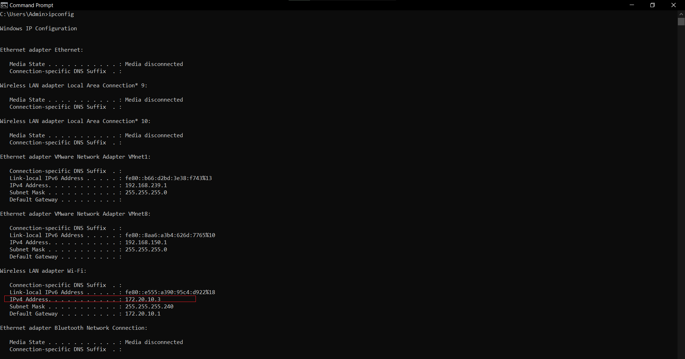
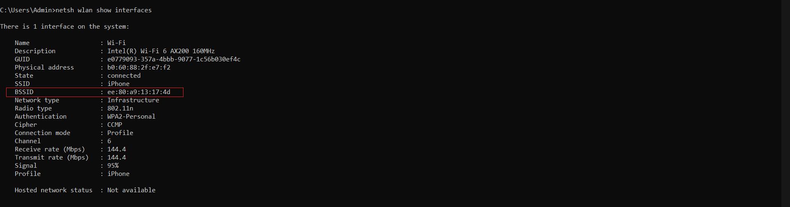
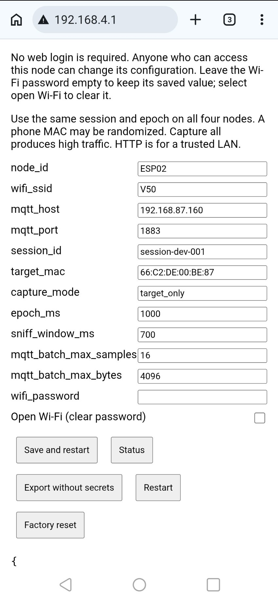
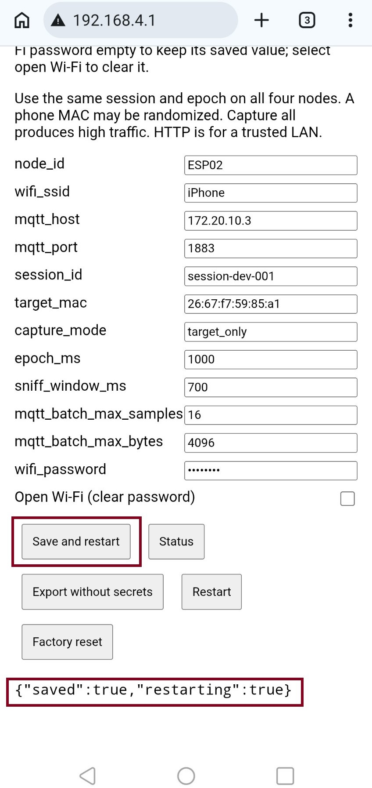
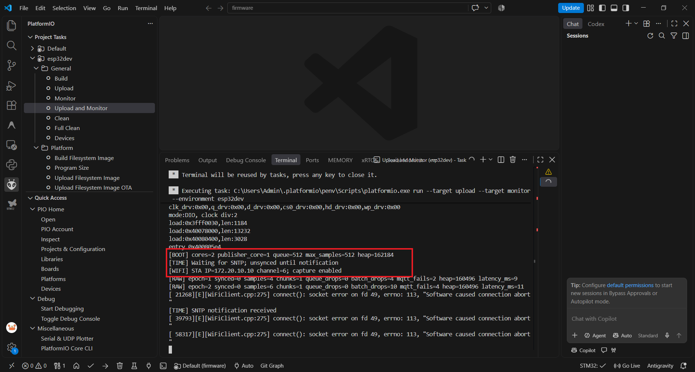

# Hướng dẫn chạy RF Localization

## 1. Kết nối hotspot và xem thông số

Bật hotspot **2.4 GHz**, dữ liệu di động và cho phép ít nhất **5 thiết bị** kết nối: laptop + 4 ESP32. Trên iPhone, bật **Tối đa hóa tương thích** nếu có.

Kết nối laptop vào hotspot. Mở PowerShell:

```powershell
ipconfig
netsh wlan show interfaces
```

Ghi lại thông tin của Wi-Fi đang kết nối:

| Thông số | Lấy ở đâu | Dùng để điền |
|---|---|---|
| IPv4 laptop | `ipconfig` → Wireless LAN adapter Wi-Fi → IPv4 Address | MQTT host |
| SSID | `netsh wlan show interfaces` → SSID | Tên Wi-Fi |
| BSSID | `netsh wlan show interfaces` → BSSID | MAC mục tiêu của điện thoại phát hotspot |
| Channel | `netsh wlan show interfaces` → Channel | Kiểm tra kênh trên ESP32 |

Không lấy Physical address của laptop làm MAC mục tiêu. BSSID có thể đổi khi bật lại hotspot; luôn dùng giá trị vừa đọc.

**IPv4 Wi-Fi → MQTT host** (lệnh script chạy: `ipconfig`):



**BSSID → Target MAC** (lệnh script chạy: `netsh wlan show interfaces`):



Các hình chụp ở thời điểm khác nhau: ảnh BSSID là `EE:80:A9:13:17:4D`, còn ảnh cấu hình bên dưới dùng MAC cũ. Điền BSSID hiện tại giống nhau trên cả 4 ESP32 và gateway, không chép cố định từ ảnh.

## 2. Chuẩn bị laptop — chỉ làm lần đầu

Cài Python, Mosquitto và extension PlatformIO trong VSCode. Mở terminal tại thư mục gốc project:

```powershell
cd "C:\Users\Admin\Downloads\do an"
py -m venv .venv
& .\.venv\Scripts\python.exe -m pip install -r .\gateway\requirements.txt
```

Nếu đã có venv hoạt động và đã cài thư viện thì bỏ qua. Không cần activate khi chạy bằng đường dẫn Python như trong hướng dẫn.

Mở PowerShell **Run as administrator**, cho phép ESP32 kết nối broker; nếu đã tạo rule này thì bỏ qua:

```powershell
New-NetFirewallRule -DisplayName "RF MQTT 1883" -Direction Inbound -Action Allow -Protocol TCP -LocalPort 1883 -RemoteAddress LocalSubnet -Profile Any
```

Nếu dịch vụ Mosquitto đang chạy, dừng nó trước khi chạy broker trong VSCode:

```powershell
Get-Service mosquitto
Stop-Service mosquitto
```

## 3. Build, nạp và cấu hình từng ESP32

1. Mở folder `firmware` trong VSCode có PlatformIO. Cắm một ESP32 qua USB.
2. Vào **PlatformIO → Project Tasks → esp32dev → General → Build**.
3. Chọn **Upload and Monitor**.
4. Khi chưa có cấu hình Wi-Fi, ESP32 phát mạng **RF-Setup-…** không mật khẩu. Kết nối laptop vào mạng đó, mở **http://192.168.4.1**.
5. Điền bảng dưới rồi bấm **Save and restart**. Kết nối laptop lại hotspot điện thoại.
6. Lặp lại cho đủ 4 con. Nếu ESP32 đã lưu Wi-Fi, mở IP hiện trong Serial ở dòng `[WIFI] STA IP=…` để chỉnh; giữ BOOT khoảng 3 giây để xóa cấu hình nếu cần làm lại.

| Trường trên web ESP32 | Giá trị |
|---|---|
| `node_id` | Mỗi con một ID: `ESP01`, `ESP02`, `ESP03`, `ESP04` |
| `wifi_ssid` | SSID hotspot điện thoại |
| `wifi_password` | Mật khẩu hotspot; để trống khi sửa sẽ giữ mật khẩu đã lưu |
| `mqtt_host` | IPv4 laptop, ví dụ `172.20.10.3` |
| `mqtt_port` | Giữ `1883` |
| `session_id` | Giữ `session-dev-001`, giống nhau trên cả 4 con |
| `target_mac` | BSSID hotspot, ví dụ `26:67:F7:59:85:A1` |
| `capture_mode` | Giữ `target_only` |
| `epoch_ms` | Giữ `1000` |
| `sniff_window_ms` | Giữ `700` |
| `mqtt_batch_max_samples` | Giữ `16` |
| `mqtt_batch_max_bytes` | Giữ `4096` |

Không chọn **Open Wi-Fi** nếu hotspot có mật khẩu. Không cần sửa code theo từng node; cấu hình được lưu trên ESP32. `DEVICE_TOKEN_SALT` trong firmware và gateway phải giống nhau; giữ mặc định nếu chưa thay đổi.

**Cấu hình cũ lưu trong NVS** — thay Wi-Fi, MQTT host và Target MAC theo mạng hiện tại:



**Sau khi điền và bấm Save and restart**, trang trả về `saved: true, restarting: true`:



**Sau khi ESP32 kết nối hotspot**, đọc IP của ESP tại dòng `[WIFI] STA IP=…` để mở lại web cấu hình. Đây là IP ESP32, không phải MQTT host:



Ảnh Serial có lỗi MQTT vì broker chưa sẵn sàng lúc chụp. Kết nối Wi-Fi thành công chưa có nghĩa MQTT đã kết nối; tiếp tục mục 4.

## 4. Chạy hệ thống — giữ 2 terminal mở

Mở thư mục gốc project trong VSCode. Đảm bảo laptop và cả 4 ESP32 đang dùng cùng hotspot.

**Terminal 1 — Mosquitto:**

```powershell
cd "C:\Users\Admin\Downloads\do an"
& "C:\Program Files\mosquitto\mosquitto.exe" -c ".\scripts\mosquitto.conf" -v
```

Giữ terminal chạy. Nếu báo cổng 1883 bị chiếm, dừng dịch vụ Mosquitto theo mục 2 và đóng broker chạy trùng rồi thử lại.

**Terminal 2 — Gateway:** sửa IPv4 và BSSID theo mục 1 trước khi chạy.

```powershell
cd "C:\Users\Admin\Downloads\do an"

$env:MQTT_HOST = "172.20.10.3"
$env:MQTT_PORT = "1883"
$env:TARGET_DEVICE_MAC = "26:67:F7:59:85:A1"
$env:TARGET_DEVICE_TOKEN = ""
$env:DATABASE_PATH = "database/rf_gateway.db"

& .\.venv\Scripts\python.exe -m uvicorn main:app --app-dir gateway --host 0.0.0.0 --port 8000
```

Chờ log `MQTT connected; subscriptions installed`. Cấu hình gateway ở trên dùng cùng IPv4 laptop với các ESP32 cho cả Android và iPhone.

## 5. Mở web và đo

1. Mở **http://127.0.0.1:8000**. Dùng session **session-dev-001**, giống cấu hình ESP32.
2. Kiểm tra **http://127.0.0.1:8000/health**: `mqtt_connected: true`, cả 4 node `online: true`.
3. Trên trang Status của mỗi ESP32, kiểm tra `wifi_connected`, `mqtt_connected`, `clock_synced` đều `true`.
4. Đặt các node ở 4 góc: ESP01 `(0,0)`, ESP02 `(rộng,0)`, ESP03 `(0,dài)`, ESP04 `(rộng,dài)`. Nhập đúng kích thước phòng và ô lưới trên dashboard.
5. Chờ **Nodes Used = 4** và có RSSI vector/vị trí rồi mới ghi nhận kết quả. Di chuyển điện thoại phát hotspot tới các điểm đã biết để so sánh vị trí thực với kết quả.

Dữ liệu lưu tại **database/rf_gateway.db**. Giữ hai terminal ở mục 4 chạy trong suốt buổi đo.

## 6. Nếu web chưa nhận node

Mở terminal thứ 3 để kiểm tra; nhập IPv4 laptop khi được hỏi:

```powershell
& "C:\Program Files\mosquitto\mosquitto_sub.exe" -h 172.20.10.3 -p 1883 -t "rf/#" -v
```

- Có dòng `rf/v1/nodes/ESP01/observation {...}`: broker đã nhận dữ liệu. Kiểm tra gateway dùng cùng MQTT host; xem log có `MQTT message rejected` không.
- Không có dữ liệu: kiểm tra MQTT host trên ESP32, broker và firewall; khởi động lại một ESP32 để thử.
- Node online nhưng chưa có vị trí: kiểm tra BSSID mục tiêu, salt, session, đồng bộ giờ và đủ mẫu từ cả 4 node.

Terminal `mosquitto_sub` chỉ để kiểm tra, có thể tắt. Không tắt terminal `mosquitto.exe` hoặc gateway khi đang đo.

Lần chạy sau: kết nối hotspot → kiểm tra lại IPv4/BSSID → cập nhật cấu hình nếu đổi → cấp nguồn 4 ESP32 → chạy mục 4 → mở web. Không cần flash lại nếu firmware không đổi.
