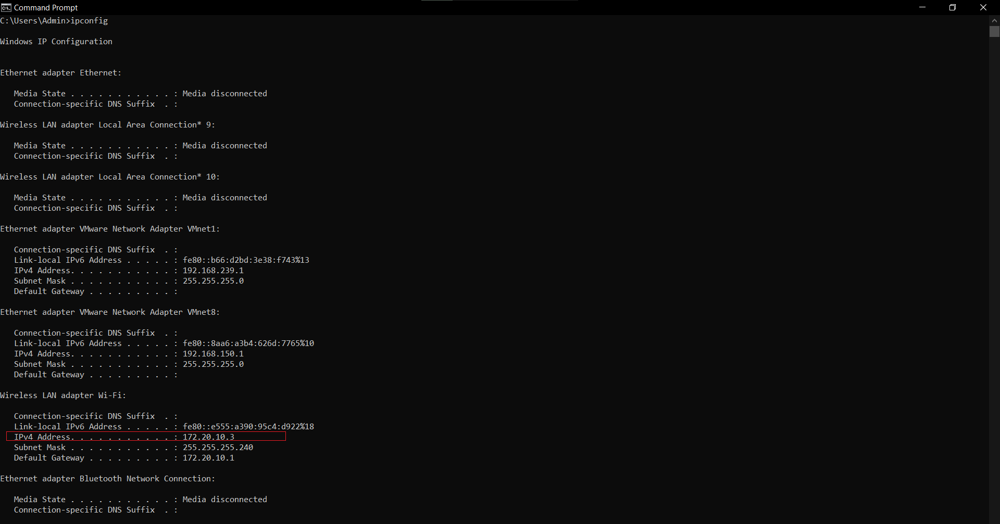
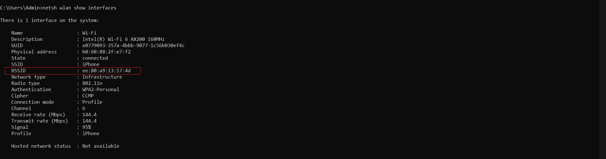

# Hướng dẫn chạy RF Localization

## 1. Kết nối hotspot và xem thông số

Bật hotspot **2.4 GHz**, dữ liệu di động và cho phép ít nhất **5 thiết bị** kết nối: laptop + 4 ESP32. Trên iPhone, bật **Tối đa hóa tương thích** nếu có.

Kết nối laptop vào hotspot. Mở PowerShell:

```powershell
ipconfig
netsh wlan show interfaces
```

Ghi lại thông tin của Wi-Fi đang kết nối:

| Thông số | Lấy ở đâu | Dùng để điền |
|---|---|---|
| IPv4 laptop | `ipconfig` → Wireless LAN adapter Wi-Fi → IPv4 Address | MQTT host |
| SSID | `netsh wlan show interfaces` → SSID | Tên Wi-Fi |
| BSSID | `netsh wlan show interfaces` → BSSID | MAC mục tiêu của điện thoại phát hotspot |
| Channel | `netsh wlan show interfaces` → Channel | Kiểm tra kênh trên ESP32 |

Không lấy Physical address của laptop làm MAC mục tiêu. BSSID có thể đổi khi bật lại hotspot; luôn dùng giá trị vừa đọc.

**IPv4 Wi-Fi → MQTT host** (lệnh script chạy: `ipconfig`):



**BSSID → Target MAC** (lệnh script chạy: `netsh wlan show interfaces`):



Các hình chụp ở thời điểm khác nhau: ảnh BSSID là `EE:80:A9:13:17:4D`, còn ảnh cấu hình bên dưới dùng MAC cũ. Điền BSSID hiện tại giống nhau trên cả 4 ESP32 và gateway, không chép cố định từ ảnh.

## 2. Chuẩn bị laptop — chỉ làm lần đầu

Cài Python, Mosquitto và extension PlatformIO trong VSCode. Mở terminal tại thư mục gốc project:

```powershell
cd "C:\Users\Admin\Downloads\do an"
py -m venv .venv
& .\.venv\Scripts\python.exe -m pip install -r .\gateway\requirements.txt
```

Nếu đã có venv hoạt động và đã cài thư viện thì bỏ qua. Không cần activate khi chạy bằng đường dẫn Python như trong hướng dẫn.

Mở PowerShell **Run as administrator**, cho phép ESP32 kết nối broker; nếu đã tạo rule này thì bỏ qua:

```powershell
New-NetFirewallRule -DisplayName "RF MQTT 1883" -Direction Inbound -Action Allow -Protocol TCP -LocalPort 1883 -RemoteAddress LocalSubnet -Profile Any
```

Nếu dịch vụ Mosquitto đang chạy, dừng nó trước khi chạy broker trong VSCode:

```powershell
Get-Service mosquitto
Stop-Service mosquitto
```

## 3. Build, nạp và cấu hình từng ESP32

1. Mở folder `firmware` trong VSCode có PlatformIO. Cắm một ESP32 qua USB.
2. Vào **PlatformIO → Project Tasks → esp32dev → General → Build**.
3. Chọn **Upload and Monitor**.
4. Khi chưa có cấu hình Wi-Fi, ESP32 phát mạng **RF-Setup-…** không mật khẩu. Kết nối laptop vào mạng đó, mở **http://192.168.4.1**.
5. Điền bảng dưới rồi bấm **Save and restart**. Kết nối laptop lại hotspot điện thoại.
6. Lặp lại cho đủ 4 con. Nếu ESP32 đã lưu Wi-Fi, mở IP hiện trong Serial ở dòng `[WIFI] STA IP=…` để chỉnh; giữ BOOT khoảng 3 giây để xóa cấu hình nếu cần làm lại.

| Trường trên web ESP32 | Giá trị |
|---|---|
| `node_id` | Mỗi con một ID: `ESP01`, `ESP02`, `ESP03`, `ESP04` |
| `wifi_ssid` | SSID hotspot điện thoại |
| `wifi_password` | Mật khẩu hotspot; để trống khi sửa sẽ giữ mật khẩu đã lưu |
| `mqtt_host` | IPv4 laptop, ví dụ `172.20.10.3` |
| `mqtt_port` | Giữ `1883` |
| `session_id` | Giữ `session-dev-001`, giống nhau trên cả 4 con |
| `target_mac` | BSSID hotspot, ví dụ `26:67:F7:59:85:A1` |
| `capture_mode` | Giữ `target_only` |
| `epoch_ms` | Giữ `1000` |
| `sniff_window_ms` | Giữ `700` |
| `mqtt_batch_max_samples` | Giữ `16` |
| `mqtt_batch_max_bytes` | Giữ `4096` |

Không chọn **Open Wi-Fi** nếu hotspot có mật khẩu. Không cần sửa code theo từng node; cấu hình được lưu trên ESP32. `DEVICE_TOKEN_SALT` trong firmware và gateway phải giống nhau; giữ mặc định nếu chưa thay đổi.

**Cấu hình cũ lưu trong NVS** — thay Wi-Fi, MQTT host và Target MAC theo mạng hiện tại:


**Sau khi điền và bấm Save and restart**, trang trả về `saved: true, restarting: true`:


**Sau khi ESP32 kết nối hotspot**, đọc IP của ESP tại dòng `[WIFI] STA IP=…` để mở lại web cấu hình. Đây là IP ESP32, không phải MQTT host:


Ảnh Serial có lỗi MQTT vì broker chưa sẵn sàng lúc chụp. Kết nối Wi-Fi thành công chưa có nghĩa MQTT đã kết nối; tiếp tục mục 4.

## 4. Chạy hệ thống — giữ 2 terminal mở

Mở thư mục gốc project trong VSCode. Đảm bảo laptop và cả 4 ESP32 đang dùng cùng hotspot.

**Terminal 1 — Mosquitto:**

```powershell
cd "C:\Users\Admin\Downloads\do an"
& "C:\Program Files\mosquitto\mosquitto.exe" -c ".\scripts\mosquitto.conf" -v
```

Giữ terminal chạy. Nếu báo cổng 1883 bị chiếm, dừng dịch vụ Mosquitto theo mục 2 và đóng broker chạy trùng rồi thử lại.

**Terminal 2 — Gateway:** sửa IPv4 và BSSID theo mục 1 trước khi chạy.

```powershell
cd "C:\Users\Admin\Downloads\do an"

$env:MQTT_HOST = "172.20.10.3"
$env:MQTT_PORT = "1883"
$env:TARGET_DEVICE_MAC = "CA:88:82:14:E5:79"
$env:DATABASE_PATH = "database/house_collect.db"

& .\.venv\Scripts\python.exe -m uvicorn main:app --app-dir gateway --host 0.0.0.0 --port 8000
```

Chờ log `MQTT connected; subscriptions installed`. Cấu hình gateway ở trên dùng cùng IPv4 laptop với các ESP32 cho cả Android và iPhone.

## 5. Mở web và chọn chế độ

Giữ hai terminal ở mục 4 chạy. Mở **http://127.0.0.1:8000**.

Ở **cuối gateway/main.py**, trước dòng `runtime = GatewayRuntime()`, chọn:

~~~python
COLLECTION_MODE = False
~~~

| Cờ | Hoạt động |
|---|---|
| `False` | Realtime cũ: RSSI → ghép epoch → WCL → EMA → vị trí trên web |
| `True` | Collection: chọn ô, thu raw 30 giây và xuất bảng RSSI vector 8 cột kèm Ground Truth |

Sau khi sửa cờ: **Ctrl+C dừng gateway → chạy lại lệnh gateway ở mục 4 → tải lại web**. Nếu vẫn thấy giao diện cũ, kiểm tra cờ là `True` và bấm Ctrl+F5.

**Không cần nạp lại firmware ESP32.** Wi-Fi, MQTT, Target MAC và lịch thu/gửi hiện tại giữ nguyên.

Đặt 4 node ở các góc: ESP01 (0,0), ESP02 (rộng,0), ESP03 (0,dài), ESP04 (rộng,dài). Nhập đúng kích thước phòng và ô lưới, bấm Apply. Session trên web phải giống cả 4 ESP32.

Ở Realtime, chờ đủ 4 node online và Nodes Used = 4. Chấm cam là WCL gốc, chấm xanh là vị trí sau EMA.

## 6. Collection — bấm là đo

1. Đặt `COLLECTION_MODE = True` và chạy lại gateway.
2. Chờ **4/4 READY**: các node có MQTT mới, đúng session và NTP hợp lệ.
3. Click chọn ô. Đặt điện thoại đúng **chấm vàng ở tâm ô**, kiểm tra Zone / True X / True Y.
4. Đánh dấu xác nhận, bấm **Start Measurement (30s)**. Gateway bắt đầu ngay khi nhận lệnh; không đếm ngược trước khi đo.
5. Giữ điện thoại yên trong 30 giây. Đợi `Measuring → Receiving → Completed/Partial`.
6. Chọn ô khác hoặc đo lại ô cũ. Mỗi lượt có ID và số run riêng, không ghi đè.
7. Bấm **Export Dataset CSV (8 columns)** để tải bảng chính đúng định dạng yêu cầu. **Export Raw Frames CSV (details)** là file chi tiết từng frame, dùng để đối chiếu.

**Hai bảng riêng:** mỗi frame vẫn giữ nguyên RSSI, timestamp thu và node trong bảng raw. Bảng `rssi_vectors` lấy median của mỗi node trong cửa sổ Unix 1 giây để tạo một dòng 4 node. Nhận -51, -53, -70 thì raw vẫn có đủ ba giá trị; ô vector đại diện là -53. Không chạy EMA/WCL trong Collection và không ghi đè raw bằng median.

**Bảng chính trên web và CSV có đúng 8 cột:**

`session | timestamp | Zone | ESP01 - RSSI | ESP02 - RSSI | ESP03 - RSSI | ESP04 - RSSI | Vector RSSI`

- `timestamp`: Unix ms đầu cửa sổ 1 giây, không phải thời gian MQTT tới.
- Thứ tự vector luôn ESP01, ESP02, ESP03, ESP04. Thiếu node: SQLite/CSV `NULL`, JSON `null`; không điền giá trị giả.
- `Zone`: ô Ground Truth đã chọn, không phải zone dự đoán. Mỗi lượt có ID riêng trong DB, kể cả đo lại cùng ô.
- Start vẫn bắt đầu ngay; lượt 30 giây không tròn giây có thể chạm 31 cửa sổ Unix. Mẫu ngoài khoảng đo không được đưa vào vector có Ground Truth của lượt đó.

**Receiving trong 3 giây cuối:** chỉ đợi gói đã thu đi tới gateway, không đo thêm. Mẫu thu ngoài 30 giây không được gắn vào lượt đó. Chờ Receiving xong rồi chuyển ô.

**Gán theo giờ thu:** ví dụ lượt A từ 10:00:00 đến 10:00:30; mẫu thu lúc 10:00:29 nhưng tới lúc 10:00:31 vẫn thuộc lượt A, không thuộc ô của lượt B. Mẫu tới sau Receiving vẫn được lưu đúng lượt cũ.

**Một SQLite duy nhất:** `database/rf_gateway.db`.

- `measurements`: ID lượt, session, zone, tâm ô True X/Y, thời gian, trạng thái và cấu hình phòng/node.
- `raw_rssi_samples`: từng frame với RSSI, timestamp thu, node, loại frame, thời gian gateway nhận và ID lượt.
- `rssi_vectors`: các dòng median/NULL theo cửa sổ Unix, khóa theo session + lượt đo + timestamp; giữ riêng với raw.
- Dữ liệu lịch sử được giữ nguyên. Sau khi cập nhật code và chạy lại gateway, vector của những lượt đã thu được tự dựng từ raw có sẵn, không cần đo lại.

CSV dataset chính chỉ xuất các lượt đã đăng ký đo, nên không lẫn những frame trước Start có Zone trống. CSV raw chi tiết vẫn có thể chứa mẫu ngoài lượt đo với ID lượt/Ground Truth trống; thêm True X/Y, run và metadata phòng. Dataset không ghi MAC/device token; vẫn chọn mục tiêu theo Target MAC/salt cũ.

`Completed`: có mẫu của cả 4 node trong mỗi giây của lượt đo, không ghi nhận gián đoạn/rớt mẫu. Chỉ đếm để kiểm tra chất lượng, không sửa RSSI; không bảo đảm nhận mọi frame vô tuyến. Thiếu dữ liệu thì báo `Partial` và vẫn giữ mẫu đã nhận.

## 7. Nếu chưa nhận dữ liệu

- `/health` cần có `mqtt_connected: true`. Khi Collection, xem 4/4 READY trên web.
- ESP32 dùng IPv4 laptop làm MQTT host; gateway phải vào cùng broker.
- Kiểm tra session, Target MAC/BSSID hiện tại, salt và `clock_synced: true`.
- Terminal kiểm tra bên dưới dùng IP ví dụ; thay nếu IPv4 laptop khác:

~~~powershell
& "C:\Program Files\mosquitto\mosquitto_sub.exe" -h 172.20.10.3 -p 1883 -t "rf/#" -v
~~~

Có observation nhưng web chưa nhận: xem log gateway có `MQTT message rejected` hoặc lỗi SQLite không. Không có bản tin: kiểm tra Mosquitto, firewall và MQTT host trên ESP32.

Có thể tắt terminal `mosquitto_sub`; phải giữ Mosquitto và gateway chạy khi đo. Firmware cũ dùng QoS0 và Queue hữu hạn, vẫn có thể mất mẫu khi mạng lỗi, RAM đầy hoặc mất điện.

## 8. Các file scripts

| File | Công dụng | Khi đo có cần chạy? |
|---|---|---|
| `start_mqtt.bat` | Mở Mosquitto bằng `scripts/mosquitto.conf` | Có thể thay lệnh terminal 1 |
| `start_gateway.bat` | Mở gateway bằng Python trong `.venv` của project | Có thể thay lệnh terminal 2 |
| `check_collection.py` | Kiểm tra Start ngay, raw không đổi, đo lại, mẫu trễ, chống trùng và DB | Không; chỉ kiểm tra code |
| `check_position_filter.py` | Kiểm tra WCL/EMA, OFF, reset và DB cũ | Không; chỉ kiểm tra code |

Hai file kiểm tra có logic kiểm thử riêng, dùng DB tạm; gateway không gọi chúng khi đo. Hai file .bat có công dụng nên được giữ lại. Đặt biến MQTT/Target theo mục 4 trong PowerShell trước khi gọi script gateway; script kế thừa các biến đó.

~~~powershell
# Terminal 1:
.\scripts\start_mqtt.bat

# Terminal 2, sau khi đặt biến môi trường ở mục 4:
.\scripts\start_gateway.bat
~~~

Không chạy cả lệnh dài lẫn .bat cho cùng chương trình để tránh trùng broker/gateway.

Lệnh kiểm tra code — không bắt buộc cho mỗi buổi đo:

~~~powershell
& .\.venv\Scripts\python.exe -m compileall -q gateway
& .\.venv\Scripts\python.exe scripts/check_position_filter.py
& .\.venv\Scripts\python.exe scripts/check_collection.py
~~~

## 9. EMA — chỉ dành cho Realtime

Đặt trong cùng terminal trước khi chạy gateway:

~~~powershell
$env:POSITION_FILTER_MODE = "ema"  # off để tắt
$env:POSITION_EMA_ALPHA = "0.35"
$env:POSITION_EMA_RESET_GAP = "3"
~~~

Khởi động lại gateway sau khi đổi tham số. EMA làm mượt tọa độ sau WCL, không sửa RSSI raw. Các tham số này không áp dụng cho Collection.
